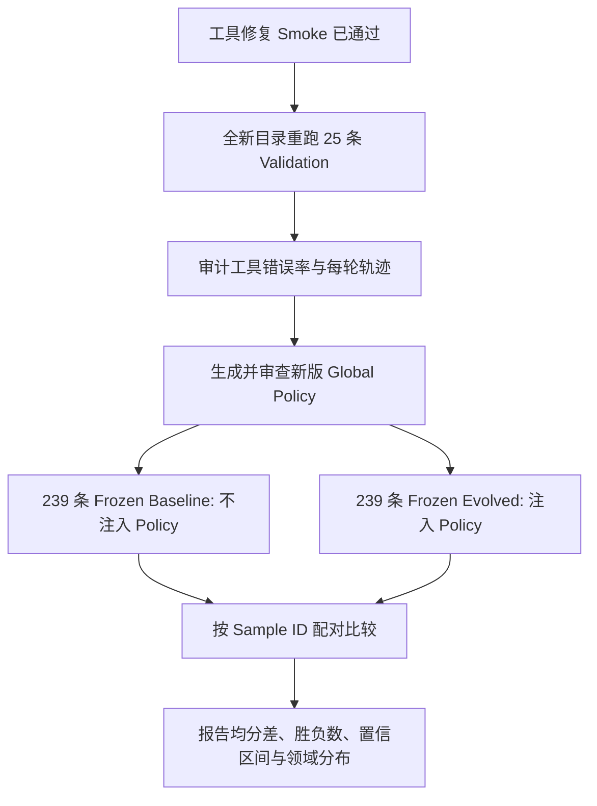

# OpenEvo × DiscoveryBench 进化实验阶段总结与问题排查

> 时间范围：2026-08-25 至 2026-08-27
> 实验环境：AstaBench / DiscoveryBench、Inspect AI、Docker sandbox、GPT-5.5
> 本文结论基于已同步到本地的 validation 产物、两次未完成的 frozen test 日志，以及服务器实际运行版本的 adapter/solver 代码。

## 1. 目标与正确实验边界

本轮工作的目标是：在 DiscoveryBench validation 上执行 OpenEvo 进化，汇总得到冻结的全局策略，再在完整 test 上评估进化后的泛化性能。

官方数据划分为：

| Split | 样本数 | 用途 |
|---|---:|---|
| Validation / Dev | 25 | 允许读取评分反馈并进化 |
| Test | 239 | 使用冻结策略评测，不允许依据 test 反馈继续进化 |
| 合计 | 264 | DiscoveryBench real tasks |

因此，规范流程应为：


早期将 `--sample-count 239` 用于 `discoverybench_validation` 是不正确的。validation 实际只有 25 条；第 26 条以后 Inspect 没有选中任何样本，却以顶层 `status=success` 退出，adapter 因而生成了虚假的 `success + 0 分` 记录。该边界问题现已修复。

## 2. 主要实验记录

### 2.1 早期 239-placeholder validation 运行

运行目录：

```text
openevo-discoverybench-validation-239sample-core-artifacts-20260826_152700
```

该运行中只有 `sample-001` 至 `sample-025` 是真实 DiscoveryBench validation 样本；`sample-026` 至 `sample-060` 的日志均满足：

```text
samples = []
results = null
model_usage = {}
events = []
```

后续仍能观察到 GPT-5.5 调用和 memory/skill/agent-system 文件，是因为 reflector 根据“空 completion + 0 分”继续生成了进化文档，并非 DiscoveryBench agent 真正执行了样本。故该运行的 summary、charts 及第 26 条以后的进化产物不能用于评价 OpenEvo。

### 2.2 完整 25-sample validation（修复样本边界后、修复工具前）

运行目录：

```text
openevo-discoverybench-validation-25sample-evo3-final-20260827_063534
```

参数要点：

```text
样本数             25
max_evolutions      3（evo=0,1,2,3）
max_steps           24
target_score        0.8
```

结果如下：

| 指标 | 初始 | 最终 | 最佳 |
|---|---:|---:|---:|
| 平均分 | 0.330 | 0.450 | 0.476 |
| 满分率 | 12% | 24% | - |
| 满分样本数 | 3 | 6 | - |

配对统计：25 条中有 9 条最终分高于初始分，2 条最终退步，14 条不变。仅看 validation 分数，sample-local evolution 显示出正向提升：平均分绝对增加约 0.120，相对增加约 36.4%，满分率翻倍。

```mermaid
xychart-beta
    title "25-sample Validation 分数"
    x-axis [初始, 最终, 最佳]
    y-axis "平均分" 0 --> 0.55
    bar [0.330, 0.450, 0.476]
```

但完整日志同时显示，该结果受到严重工具故障影响：

| 工具统计 | 数量 | 占比 |
|---|---:|---:|
| 工具结果总数 | 1189 | 100% |
| 有效工具结果 | 134 | 11.3% |
| 工具错误 | 1055 | 88.7% |
| `python_session` 缺少 `code` | 1055 | 88.7% |

所有工具错误均为：

```text
python_session {}
Found 1 validation errors parsing tool input arguments:
- 'code' is a required property
```

因此，旧 validation 的分数提升是真实 scorer 结果，但它发生在工具调用高度失效的条件下；由这些轨迹生成的 global policy 不能视为可靠的最终 OpenEvo 状态。

### 2.3 两次未完成的 239-sample frozen test

运行目录：

```text
openevo-discoverybench-test-239sample-frozen-batch5-20260827_163413
openevo-discoverybench-test-239sample-frozen-batch5-rerun-20260827_175604
```

两次 test 均正确配置为：

```text
task              astabench/discoverybench_test
max_samples       5
max_sandboxes     5
max_steps         24
revision_manifest validation 生成的同一个 global_policy.md
```

两次运行均被手动暂停，不能代表完整 test 成绩：

| 运行 | 已完成 | 部分均分 | 0 分样本 | 满分样本 | 工具错误率 |
|---|---:|---:|---:|---:|---:|
| Test A | 99/239 | 0.085 | 87 | 5 | 96.5% |
| Test B | 54/239 | 0.113 | 43 | 1 | 96.7% |

两次共同完成 51 条；在相同 policy 下，Test A 均分为 0.136，Test B 为 0.111。其中 4 条提升、7 条退步、40 条不变。这说明当前结果存在较大随机性，且主要受“工具是否偶然调用成功”影响，而不是两次运行之间发生了策略变化。

另外，并行暂停后完成的样本并非数据集前 N 条，而是当时较早完成的样本，领域分布并不均匀。因此不能将部分 test 均分直接与完整 validation 均分比较，也不能据此断言进化后泛化性能下降。

```mermaid
xychart-beta
    title "未完成 Frozen Test 的工具错误率"
    x-axis [Validation旧运行, Test-A, Test-B, 修复后Smoke]
    y-axis "错误率(%)" 0 --> 100
    bar [88.7, 96.5, 96.7, 9.1]
```

## 3. 根因分析

### 3.1 根因一：solver 丢失工具错误信息

Inspect 将参数解析失败保存在 tool message 的独立 `error` 字段中，而旧 solver 的 `_messages_for_model()` 只读取 `content`。由于解析失败时 `content` 为空，模型下一轮实际看到的是：

```text
Tool result from python_session:
```

模型不知道自己遗漏了 `code`，于是重复调用 `python_session {}`，最多连续浪费 24 个步骤。该问题与 `ASTA_TOOL_KEY` 无关：`python_session` 是 Docker/Jupyter 本地工具，错误发生在参数校验阶段，尚未进入 sandbox。`ASTA_TOOL_KEY` 只影响 Asta 搜索/MCP 类工具。

### 3.2 根因二：旧 global policy 放大了工具故障

旧 policy 包含以下类型的指导：

```text
When source data or files are unavailable, say so directly...
If confidence is low, produce a cautious answer...
```

这些规则在正常环境下合理，但工具错误被隐藏后，模型会误以为数据不可用，大量输出“Unable to determine”“Insufficient evidence”等保守答案。在 Test A 的 99 条中，66 条包含类似失败/保守表达，其中 61 条得 0 分；Test B 的 54 条中有 40 条类似表达，其中 34 条得 0 分。

### 3.3 根因三：旧 policy promotion 并未表示完整进化状态

旧版 `_write_task_policy_update()` 只向 reflector 提供：

- validation 聚合数字；
- 按运行顺序最前面的 20 个失败 attempt；
- 每个失败 completion 的前 280 字符。

它没有使用每个样本的最佳轨迹，也没有纳入后续样本、成功经验和回退情况。虽然运行目录中存在 memory、skill、agent-system 和 OpenEvo core artifacts，最终仅 1.4 KB 的 `global_policy.md` 并不是这些进化内容的完整综合，而是一份偏向早期失败轨迹的压缩总结。这解释了 sample-local evolution 在 validation 中提升，而冻结后的全局策略却可能偏保守。

## 4. Adapter 与 Solver 修改

### 4.1 样本边界与空评测保护

已修改 `evolution_experiment.py`：

- 固定识别 `discoverybench_validation=25`、`discoverybench_test=239`；
- validation 使用 `--sample-count 239` 时启动前报错；
- Inspect 日志无 sample 时标记为 `no_samples`；
- 发现空评测后立即停止，不再生成虚假零分和进化产物。

### 4.2 工具调用反馈修复

已修改 `solver.py`：

- system prompt 明确要求 `python_session` 提供非空 `{"code": "..."}`；
- 将 tool message 的 `error` 字段完整反馈给模型；
- 参数解析失败后明确要求修正参数；
- 失败调用不计入有效工具步骤；
- 设置总纠错轮次上限，避免无限循环；
- 保留服务器已有的 `model_client_timeout` 支持。

### 4.3 全局策略汇总修复

已修改 policy promotion：

- 按 sample 分组；
- 为每个 validation sample 选择最高分轨迹；
- 纳入所有样本的最佳 completion 摘要；
- 单独记录 final score 低于 best score 的回退样本；
- 明确禁止将工具/基础设施故障总结成“拒绝分析数据”的全局策略；
- 同时学习部分成功轨迹，而不只学习失败。

### 4.4 测试

新增 solver 测试覆盖：

- system prompt 包含 `code` 参数要求；
- 工具错误不会在消息转换中丢失；
- 失败工具调用不会被视为成功步骤。

完整测试结果：

```text
28 passed
```

## 5. 修复后 Smoke Test

运行目录：

```text
openevo-discoverybench-validation-tool-fix-smoke-20260827_185240
```

两轮分数为 `0.444 → 0.000`。单个样本的分数回退可能来自模型随机性或最终关系判断错误，不能单独用于判断修复成败；工具统计才是本次 smoke 的验收指标：

| 指标 | 修复后 Smoke |
|---|---:|
| 工具错误 | 1 |
| 缺少 `code` 错误 | 1 |
| 有效工具结果 | 10 |
| 工具错误率 | 9.1% |

旧运行中模型会将同一错误重复接近 24 次；修复后仅出现 1 次，随后成功纠正并执行了 10 次有效工具调用，说明错误反馈链路已恢复。

## 6. 当前可得结论

1. OpenEvo 的 sample-local retry 在旧 validation 中确实观察到分数提升，但旧实验受到严重工具故障干扰。
2. 两次未完成 test 的低分主要由 `python_session` 参数错误及错误反馈丢失造成，不能据此判断 OpenEvo 进化无效。
3. 旧 global policy 不能代表完整最终进化状态，其汇总逻辑偏向早期失败轨迹，并放大了工具故障后的保守回答倾向。
4. 修复后 smoke 已证明工具纠错链路有效，但仍需重新运行完整 25 条 validation 才能生成可信的新 policy。
5. 判断进化是否改善 test 泛化，必须在修复后使用同一 solver、同一模型和同一 test split，分别运行无 policy baseline 与 frozen-policy test，并按 sample ID 配对比较。

## 7. 后续实验计划

建议按以下顺序执行：



验收条件建议设为：

- validation 和 test 均无空 sample；
- `python_session` 缺少 `code` 的错误不再连续发生；
- 工具错误率显著低于旧运行；
- global policy 来源覆盖全部 25 条最佳 validation 轨迹；
- baseline 与 evolved test 都完成 239 条；
- 以同一 sample 的分数差作为主要比较，不使用两次未完成运行的非配对均分。

在完成上述实验前，旧 validation 和两次中断 test 应保留为故障诊断基线，不应作为 OpenEvo 最终性能结论。
